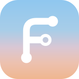

  

<h3 align="center">Every save, kept. Nothing to learn.</h3>

  Folyvo keeps saved versions of your files on your Mac. Keep using Word.

  <a href="https://folyvo.com">folyvo.com</a>

  
  

---

You shorten a proposal, change a few numbers, save over a paragraph you meant to keep. Usually the old file is gone behind the new one. With Folyvo running, every earlier save is still there.

Choose a folder. Then work in Word, Excel, or any app you already use. There is nothing to set up for each file and no new words to learn.

## What it does

- **Keeps every save.** Each time a file in your folder is saved, Folyvo keeps that version. Open it from the menu bar or from Finder's right-click menu.
- **Shows what changed.** Under each saved time, a line says what changed since the save before: "2 paragraphs changed", "3 cells changed", "Page 2 changed". One click shows the page with the changes marked. Works for Word, Excel, PDF and plain text.
- **Takes you back.** See your file as it was at any saved time. Restore it, or open a separate copy in Word and keep going.
- **Remembers which copy left your Mac.** Share a saved version through Mail, AirDrop or Messages, and Folyvo notes it next to that version: "Attached in Mail 10:14".
- **Knows a file when it comes back.** Right-click any file in Finder › Which One Is This?, even one with a different name, and Folyvo tells you which saved version it is. If the contents match none, it says so instead of guessing.

## On your Mac. And only your Mac.

No account. No cloud. Folyvo reads your files and keeps copies in your own Library folder. Nothing is uploaded, and nothing leaves your computer unless you send it.

## Status

Folyvo is under development and there is no download yet. The first release will be a signed app for macOS on Apple Silicon ([#51](https://github.com/bilalyazicioglu/Folyvo/issues/51)). Until then you can [run it from source](docs/development/desktop.md).

Windows is not planned yet. If you want it, add a 👍 to [#67](https://github.com/bilalyazicioglu/Folyvo/issues/67).

## For developers

Folyvo gives people who work with documents the guarantees developers get from Git, without the vocabulary: no commits, no branches, no staging.

It is a Rust workspace with a Tauri 2 and React app on top:

- `crates/folyvo-core` keeps the saves: a content-addressed store and SQLite, watching folders and reconciling on launch.
- `crates/folyvo-compare` reads Word, Excel and text files and compares two of them, with limits on size, depth and time so a hostile file cannot hang or fill the disk.
- `crates/folyvo-cli` is a small command line for the same store.
- `apps/desktop` is the menu bar app, its Finder extension and Services.

See the [documentation](docs/) and [how to run the app](docs/development/desktop.md).

## Contributing

Contributions are welcome. Please read [CONTRIBUTING.md](CONTRIBUTING.md) first, and note the [code of conduct](CODE_OF_CONDUCT.md). Issues marked [good first issue](https://github.com/bilalyazicioglu/Folyvo/labels/good%20first%20issue) or [help wanted](https://github.com/bilalyazicioglu/Folyvo/labels/help%20wanted) are a good place to start. Report security problems privately, as described in [SECURITY.md](SECURITY.md).

## License

GPL-3.0-or-later. See [LICENSE](LICENSE).
